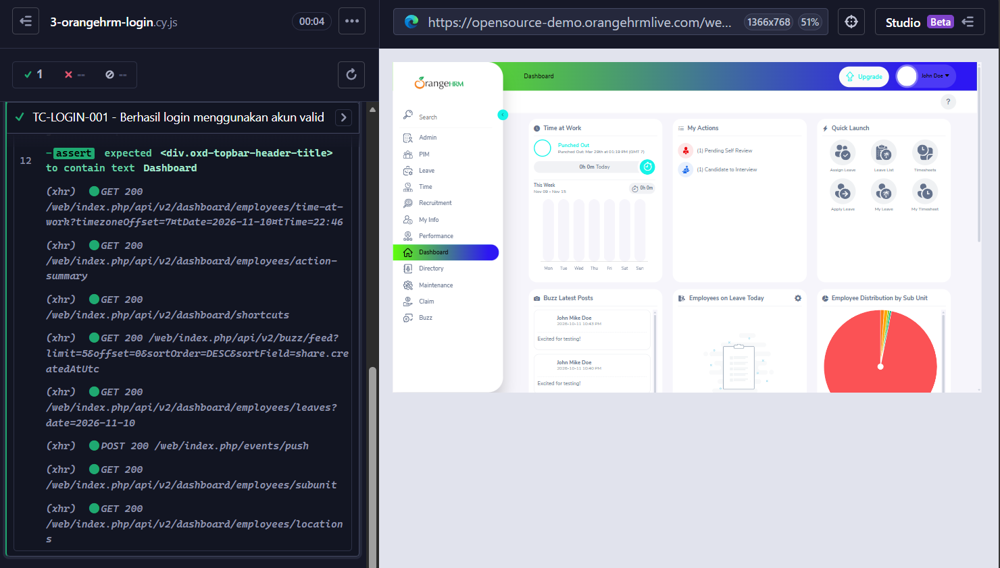
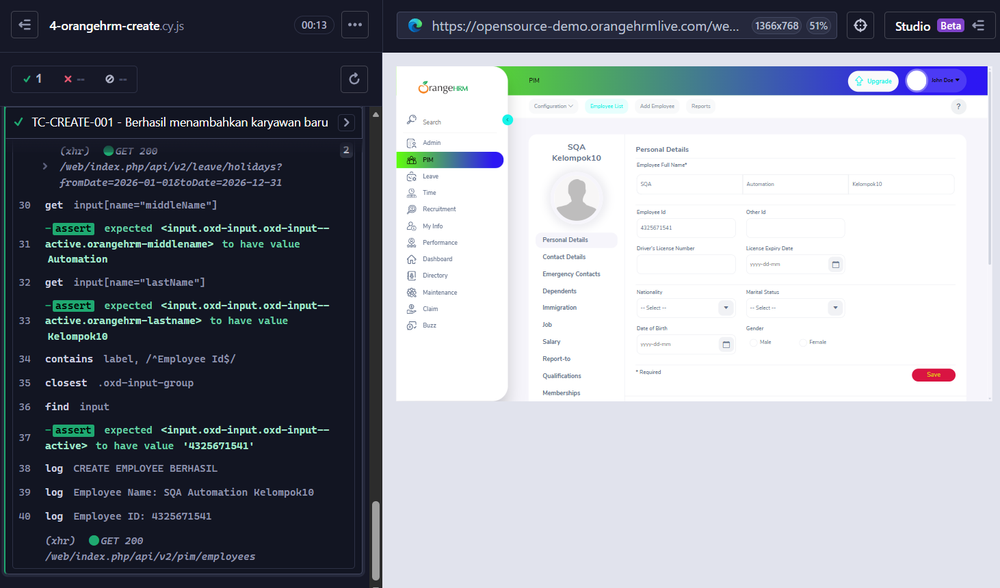
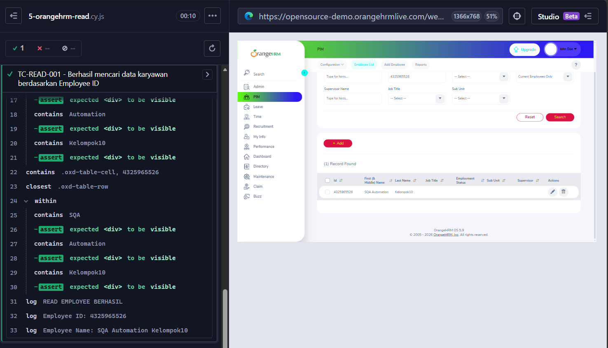
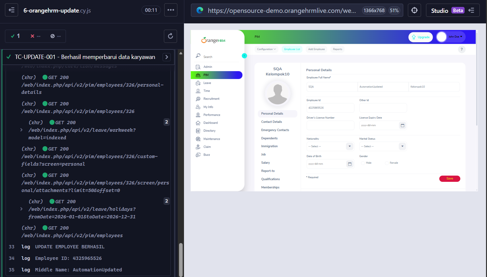
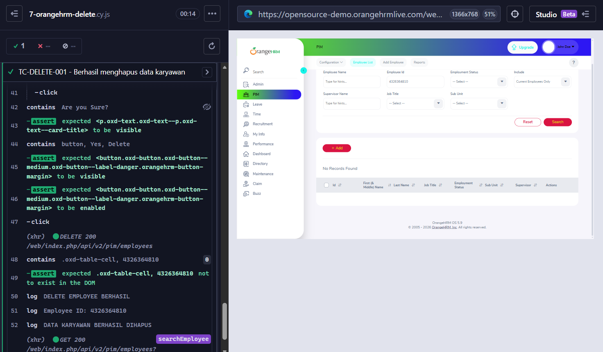

# OrangeHRM - Software Quality Assurance Testing

<p align="center">
  
</p>

<p align="center">
  **Automated Software Testing menggunakan Cypress pada OrangeHRM**
</p>

<p align="center">
  
  
  
  
</p>

---

## 1. Deskripsi Proyek

Repository ini merupakan proyek pengujian perangkat lunak (*Software Testing*) yang dikembangkan untuk memenuhi tugas kelompok mata kuliah **Software Quality Assurance (SQA)**.

Pengujian dilakukan terhadap aplikasi web **OrangeHRM**, yaitu aplikasi Human Resource Management System (HRMS) yang digunakan untuk membantu pengelolaan sumber daya manusia dalam suatu organisasi atau perusahaan.

Pada proyek ini, kami menggunakan **Cypress** sebagai framework pengujian otomatis (*Automation Testing Framework*) untuk menguji beberapa fungsi utama pada modul Personnel Information Management (PIM).

Pengujian difokuskan pada proses pengelolaan data karyawan yang mencakup:

- Login: Menguji proses autentikasi pengguna.
- Create: Menguji proses penambahan data karyawan.
- Read: Menguji proses pencarian dan pembacaan data karyawan.
- Update: Menguji proses perubahan informasi karyawan.
- Delete: Menguji proses penghapusan data karyawan.

Seluruh skenario pengujian dibuat menggunakan JavaScript dan dijalankan melalui Cypress End-to-End Testing.

**Tujuan utama proyek ini adalah memastikan bahwa fungsi-fungsi penting pada aplikasi OrangeHRM dapat berjalan sesuai dengan kebutuhan, memberikan hasil yang diharapkan, dan mengurangi kemungkinan kesalahan dalam penggunaan aplikasi.**

## 2. Tujuan Pengujian

Pengujian perangkat lunak merupakan salah satu tahapan penting dalam proses pengembangan sistem. Pengujian dilakukan untuk mengetahui apakah suatu aplikasi telah berjalan sesuai dengan kebutuhan dan spesifikasi yang diharapkan.

Melalui proyek ini, terdapat beberapa tujuan yang ingin dicapai:

### 2.1 Memastikan Fungsionalitas Aplikasi

Memastikan fitur Login dan pengelolaan data karyawan pada OrangeHRM dapat digunakan sesuai dengan fungsinya.

### 2.2 Mengidentifikasi Kesalahan Sistem

Menemukan kemungkinan kesalahan (*bug*), ketidaksesuaian proses, maupun kegagalan fungsi ketika pengguna berinteraksi dengan aplikasi.

### 2.3 Mengimplementasikan Automation Testing

Menerapkan pengujian otomatis menggunakan Cypress agar skenario pengujian dapat dijalankan secara sistematis dan berulang tanpa harus melakukan seluruh proses secara manual.

### 2.4 Memastikan Proses CRUD Berjalan

Memastikan proses Create, Read, Update, dan Delete pada modul PIM berjalan dengan benar.

### 2.5 Memverifikasi Hasil Pengujian

Memastikan setiap tindakan yang dilakukan menghasilkan kondisi sesuai dengan ekspektasi melalui penggunaan assertion pada Cypress.

### 2.6 Mendukung Kualitas Perangkat Lunak

Menerapkan konsep Software Quality Assurance untuk membantu meningkatkan kepercayaan terhadap fungsionalitas aplikasi melalui proses pengujian yang terstruktur.

## 3. Objek dan Ruang Lingkup Pengujian

### 3.1 Objek Pengujian

Aplikasi yang digunakan sebagai objek pengujian adalah OrangeHRM Open Source Demo.

- Nama aplikasi: OrangeHRM
- Jenis aplikasi: Web-Based Human Resource Management System
- Modul utama: Personnel Information Management (PIM)
- URL aplikasi: https://opensource-demo.orangehrmlive.com/

### 3.2 Ruang Lingkup

Pengujian difokuskan pada beberapa fungsi berikut:

| No. | Fitur | Deskripsi |
|---|---|---|
| 1 | Login | Menguji autentikasi pengguna |
| 2 | Create Employee | Menambahkan data karyawan |
| 3 | Read Employee | Mencari dan melihat data karyawan |
| 4 | Update Employee | Memperbarui informasi karyawan |
| 5 | Delete Employee | Menghapus data karyawan |

Pengujian dilakukan melalui antarmuka aplikasi menggunakan pendekatan End-to-End Testing.

## 4. Teknologi dan Tools yang Digunakan

Berikut teknologi dan perangkat yang digunakan dalam pengerjaan proyek.

### 4.1 Cypress

Cypress merupakan framework pengujian otomatis yang digunakan untuk menguji aplikasi web.

Pada proyek ini, Cypress digunakan untuk menjalankan skenario End-to-End Testing, berinteraksi dengan elemen halaman web, mengisi formulir, menekan tombol, melakukan navigasi, serta memverifikasi hasil pengujian.

Beberapa fungsi Cypress yang digunakan:

| Perintah | Fungsi |
|---|---|
| `describe()` | Mengelompokkan skenario pengujian |
| `it()` | Mendefinisikan satu test case |
| `beforeEach()` | Menjalankan persiapan sebelum setiap test |
| `cy.visit()` | Membuka halaman aplikasi |
| `cy.get()` | Memilih elemen berdasarkan selector |
| `cy.contains()` | Mencari elemen berdasarkan teks |
| `cy.type()` | Mengisi input |
| `cy.clear()` | Menghapus isi input |
| `cy.click()` | Melakukan klik |
| `cy.intercept()` | Memantau request HTTP |
| `cy.wait()` | Menunggu proses tertentu |
| `should()` | Melakukan assertion atau verifikasi |
| `cy.log()` | Menampilkan informasi pada Cypress Runner |

### 4.2 JavaScript

JavaScript digunakan sebagai bahasa pemrograman untuk menulis skenario pengujian.

Setiap test case disusun menggunakan struktur kode Cypress dengan memanfaatkan variabel, objek, fungsi, dan assertion.

### 4.3 OrangeHRM

OrangeHRM digunakan sebagai aplikasi target pengujian.

Aplikasi ini menyediakan fitur pengelolaan informasi karyawan yang dapat digunakan untuk menguji proses CRUD.

### 4.4 Web Browser

Microsoft Edge digunakan sebagai browser untuk menjalankan aplikasi dan menampilkan proses pengujian otomatis melalui Cypress Runner.

### 4.5 Visual Studio Code

Visual Studio Code digunakan sebagai editor untuk menulis, mengubah, dan mengelola file JavaScript pengujian.

### 4.6 Node.js dan NPM

Node.js digunakan sebagai lingkungan runtime JavaScript, sedangkan NPM digunakan untuk mengelola package dan dependency yang dibutuhkan proyek.

### 4.7 Cypress Runner

Cypress Runner merupakan antarmuka yang digunakan untuk melihat jalannya pengujian secara langsung.

Melalui Cypress Runner, kita dapat melihat:

- Daftar test case.
- Status pengujian.
- Aktivitas browser.
- Perintah Cypress yang dijalankan.
- Assertion yang berhasil atau gagal.
- Informasi request dan response aplikasi.

## 5. Arsitektur Pengujian

Proyek ini menerapkan pendekatan **End-to-End (E2E) Testing**.

Pada pendekatan ini, pengujian dilakukan melalui interaksi langsung dengan antarmuka aplikasi untuk memastikan alur penggunaan sistem berjalan sesuai dengan kebutuhan.

### 5.1 Gambaran Arsitektur

```text
+-----------------------------+
|       Test Engineer         |
|     Kelompok SQA             |
+--------------+--------------+
               |
               v
+-----------------------------+
|      Visual Studio Code     |
|       JavaScript Files      |
+--------------+--------------+
               |
               v
+-----------------------------+
|          Cypress            |
|     End-to-End Testing      |
|                             |
| - Test Runner               |
| - Commands                  |
| - Assertions                |
| - Intercept                 |
+--------------+--------------+
               |
               v
+-----------------------------+
|        Web Browser          |
|       Microsoft Edge        |
+--------------+--------------+
               |
               v
+-----------------------------+
|         OrangeHRM           |
|       Web Application       |
|                             |
| - Authentication            |
| - Employee List             |
| - Add Employee              |
| - Edit Employee             |
| - Delete Employee           |
+--------------+--------------+
               |
               v
+-----------------------------+
|      Backend / API          |
|                             |
| Request & Response          |
| HTTP Status                 |
+-----------------------------+
```

### 5.2 Penjelasan Arsitektur

**1. Test Engineer**

Anggota kelompok bertugas menyusun skenario pengujian, menulis kode, menjalankan test case, dan mengevaluasi hasil pengujian.

**2. Visual Studio Code**

Digunakan sebagai tempat pengembangan file pengujian JavaScript.

**3. Cypress**

Bertindak sebagai automation testing framework yang menjalankan perintah pengujian dan melakukan verifikasi terhadap kondisi aplikasi.

**4. Web Browser**

Browser menjadi media interaksi antara Cypress dan aplikasi OrangeHRM.

**5. OrangeHRM**

Merupakan aplikasi yang menjadi objek pengujian.

**6. Backend / API**

Aplikasi OrangeHRM berkomunikasi dengan backend melalui HTTP request. Cypress dapat memantau beberapa aktivitas request dan response untuk membantu memastikan proses pengujian berjalan dengan benar.

## 6. Struktur Direktori Proyek

Berikut struktur direktori pengujian yang digunakan:

```text
sqa-orangehrm-cypress/
│
├── cypress/
│   │
│   └── e2e/
│       │
│       ├── 1-getting-started/
│       │
│       ├── 2-advanced-examples/
│       │
│       ├── 3-orangehrm-login.cy.js
│       │
│       ├── 4-orangehrm-create.cy.js
│       │
│       ├── 5-orangehrm-read.cy.js
│       │
│       ├── 6-orangehrm-update.cy.js
│       │
│       └── 7-orangehrm-delete.cy.js
│
├── cypress.config.js
├── package.json
├── package-lock.json
├── node_modules/
│
├── docs/
│   └── screenshots/
│       ├── 01-login.png
│       ├── 02-create-employee.png
│       ├── 03-read-employee.png
│       ├── 04-update-employee.png
│       ├── 05-delete-employee.png
│       └── 06-test-results.png
│
└── README.md
```

**Keterangan:**

- `cypress/`: Direktori utama untuk konfigurasi dan kebutuhan pengujian Cypress.
- `cypress/e2e/`: Tempat penyimpanan file skenario End-to-End Testing.
- `1-getting-started/`: Contoh pengujian bawaan Cypress.
- `2-advanced-examples/`: Contoh pengujian lanjutan bawaan Cypress.
- `3-orangehrm-login.cy.js`: Skenario pengujian Login.
- `4-orangehrm-create.cy.js`: Skenario pengujian Create Employee.
- `5-orangehrm-read.cy.js`: Skenario pengujian Read Employee.
- `6-orangehrm-update.cy.js`: Skenario pengujian Update Employee.
- `7-orangehrm-delete.cy.js`: Skenario pengujian Delete Employee.
- `cypress.config.js`: Konfigurasi Cypress.
- `package.json`: Informasi proyek dan dependency.
- `docs/screenshots/`: Dokumentasi visual hasil pengujian.
- `README.md`: Dokumentasi utama repository.

Folder `node_modules/` merupakan hasil instalasi dependency dan tidak perlu dimasukkan ke repository GitHub.

## 7. Persiapan Lingkungan Pengujian

Sebelum menjalankan proyek, terdapat beberapa perangkat lunak yang perlu dipersiapkan.

### 7.1 Instalasi Node.js

Node.js dapat diunduh melalui:

https://nodejs.org/

Pastikan Node.js dan NPM sudah terpasang.

Periksa instalasi melalui terminal:

```bash
node -v
npm -v
```

### 7.2 Instalasi Visual Studio Code

Unduh Visual Studio Code melalui:

https://code.visualstudio.com/

Editor ini digunakan untuk mengelola file pengujian.

### 7.3 Clone Repository

Clone repository menggunakan perintah berikut:

```bash
git clone https://github.com/USERNAME/sqa-orangehrm-cypress.git
```

Masuk ke direktori proyek:

```bash
cd sqa-orangehrm-cypress
```

Ganti `USERNAME` dengan username GitHub pemilik repository.

### 7.4 Instalasi Dependency

Jalankan perintah:

```bash
npm install
```

Perintah tersebut digunakan untuk menginstal seluruh dependency yang telah didefinisikan dalam `package.json`.

### 7.5 Memastikan Cypress Terpasang

Periksa versi Cypress:

```bash
npx cypress version
```

Jika instalasi berhasil, informasi versi Cypress akan ditampilkan pada terminal.

### 7.6 Menjalankan Cypress

Untuk membuka Cypress secara interaktif:

```bash
npx cypress open
```

Pilih:

1. E2E Testing.
2. Pilih browser yang tersedia, misalnya Microsoft Edge.
3. Klik Start E2E Testing.
4. Pilih file pengujian yang ingin dijalankan.

Untuk menjalankan pengujian melalui terminal:

```bash
npx cypress run
```

Catatan: Perintah menjalankan seluruh file spec yang terdeteksi oleh konfigurasi Cypress.

## 8. Implementasi Skenario Pengujian

Pada bagian ini dijelaskan tahapan pengujian yang telah dibuat.

### 8.1 Login Testing

File:

`3-orangehrm-login.cy.js`

**Tujuan:**

Memastikan pengguna dapat melakukan autentikasi menggunakan username dan password yang valid.

**Tahapan pengujian:**

1. Membuka halaman login OrangeHRM.
2. Mengisi username.
3. Mengisi password.
4. Menekan tombol Login.
5. Memastikan pengguna berhasil diarahkan ke halaman Dashboard.

**Contoh implementasi:**

```javascript
cy.visit('/web/index.php/auth/login');

cy.get('input[name="username"]')
  .type('Admin');

cy.get('input[name="password"]')
  .type('PASSWORD');

cy.get('button[type="submit"]')
  .click();

cy.url()
  .should('include', '/dashboard/index');
```

**Hasil yang diharapkan:**

Pengguna berhasil masuk ke halaman Dashboard OrangeHRM.

### 8.2 Create Employee Testing

File:

`4-orangehrm-create.cy.js`

**Test Case:**

`TC-CREATE-001 - Berhasil menambahkan karyawan baru`

**Tujuan:**

Memastikan sistem dapat menyimpan data karyawan baru melalui halaman Add Employee.

**Data pengujian:**

| Field | Nilai |
|---|---|
| First Name | SQA |
| Middle Name | Automation |
| Last Name | Kelompok10 |
| Employee ID | Dibuat secara unik |

**Tahapan pengujian:**

1. Login ke OrangeHRM.
2. Membuka modul PIM.
3. Membuka halaman Add Employee.
4. Mengisi First Name.
5. Mengisi Middle Name.
6. Mengisi Last Name.
7. Mengisi Employee ID.
8. Menekan tombol Save.
9. Memastikan halaman Personal Details berhasil ditampilkan.
10. Memverifikasi data karyawan yang tersimpan.

**Implementasi utama:**

```javascript
cy.get('input[name="firstName"]')
  .type(employee.firstName);

cy.get('input[name="middleName"]')
  .type(employee.middleName);

cy.get('input[name="lastName"]')
  .type(employee.lastName);

cy.contains('label', 'Employee Id')
  .closest('.oxd-input-group')
  .find('input')
  .clear()
  .type(employeeId);

cy.get('button[type="submit"]')
  .click();

cy.url()
  .should('include', '/pim/viewPersonalDetails/');
```

**Hasil yang diharapkan:**

Data karyawan berhasil disimpan dan informasi karyawan dapat ditampilkan pada halaman Personal Details.

### 8.3 Read Employee Testing

File:

`5-orangehrm-read.cy.js`

**Test Case:**

`TC-READ-001 - Berhasil mencari data karyawan berdasarkan Employee ID`

**Tujuan:**

Memastikan sistem dapat mencari dan menampilkan data karyawan berdasarkan Employee ID.

**Tahapan pengujian:**

1. Login ke OrangeHRM.
2. Membuka halaman Employee List.
3. Memasukkan Employee ID pada kolom pencarian.
4. Menekan tombol Search.
5. Memastikan data karyawan ditemukan.
6. Memverifikasi nama depan, nama tengah, dan nama belakang karyawan pada tabel.

**Implementasi utama:**

```javascript
cy.visit('/web/index.php/pim/viewEmployeeList');

cy.contains('label', 'Employee Id')
  .closest('.oxd-input-group')
  .find('input')
  .clear()
  .type(employeeId);

cy.contains('button', 'Search')
  .click();

cy.contains('.oxd-table-cell', employeeId)
  .should('be.visible');
```

**Hasil yang diharapkan:**

Sistem berhasil menampilkan data karyawan sesuai dengan Employee ID yang dimasukkan.

### 8.4 Update Employee Testing

File:

`6-orangehrm-update.cy.js`

**Test Case:**

`TC-UPDATE-001 - Berhasil memperbarui data karyawan`

**Tujuan:**

Memastikan informasi karyawan dapat diperbarui sesuai dengan perubahan yang dilakukan pengguna.

**Contoh perubahan data:**

| Field | Data Awal | Data Baru |
|---|---|---|
| Middle Name | Automation | AutomationUpdated |

**Tahapan pengujian:**

1. Login ke OrangeHRM.
2. Membuka halaman Employee List.
3. Mencari karyawan berdasarkan Employee ID.
4. Memilih data karyawan yang ditemukan.
5. Membuka halaman Edit Employee.
6. Mengubah informasi Middle Name.
7. Menekan tombol Save.
8. Memastikan perubahan berhasil disimpan.
9. Memverifikasi nilai terbaru pada halaman Personal Details.

**Implementasi utama:**

```javascript
cy.get('input[name="middleName"]')
  .should('have.value', employee.oldMiddleName)
  .clear()
  .type(employee.newMiddleName);

// Menyimpan perubahan
cy.get('button[type="submit"]')
  .click();

// Memverifikasi hasil perubahan
cy.get('input[name="middleName"]')
  .should('have.value', employee.newMiddleName);
```

**Hasil yang diharapkan:**

Informasi karyawan berhasil diperbarui dan nilai terbaru dapat ditampilkan pada halaman Personal Details.

### 8.5 Delete Employee Testing

File:

`7-orangehrm-delete.cy.js`

**Test Case:**

`TC-DELETE-001 - Berhasil menghapus data karyawan`

**Tujuan:**

Memastikan sistem dapat menghapus data karyawan dan memastikan data tersebut tidak lagi tersedia pada daftar karyawan.

**Tahapan pengujian:**

1. Login ke OrangeHRM.
2. Membuat data karyawan khusus untuk pengujian DELETE.
3. Menghasilkan Employee ID unik menggunakan `Date.now()`.
4. Menyimpan data karyawan.
5. Membuka halaman Employee List.
6. Mencari karyawan menggunakan Employee ID.
7. Memastikan data ditemukan.
8. Menekan tombol Delete.
9. Memastikan dialog konfirmasi muncul.
10. Menekan tombol Yes, Delete.
11. Memastikan Employee ID sudah tidak ditemukan pada tabel.

**Implementasi utama:**

```javascript
cy.contains('.oxd-table-row', employeeId)
  .within(() => {

    cy.get('button')
      .last()
      .click();

  });

// Memastikan dialog konfirmasi
cy.contains('Are you Sure?')
  .should('be.visible');

// Mengonfirmasi penghapusan
cy.contains('button', 'Yes, Delete')
  .should('be.visible')
  .click();

// Memastikan data sudah tidak ada
cy.contains('.oxd-table-cell', employeeId, {
  timeout: 15000
}).should('not.exist');
```

Pada pengujian DELETE, data karyawan dibuat terlebih dahulu di dalam test case. Pendekatan ini membuat pengujian lebih mandiri karena tidak bergantung pada Employee ID dari pengujian CREATE sebelumnya.

**Hasil yang diharapkan:**

Data karyawan berhasil dihapus dan Employee ID tidak lagi ditemukan pada tabel Employee List.

## 9. Dokumentasi Screenshot Pengujian

Bagian ini digunakan untuk menampilkan bukti visual dari setiap tahapan pengujian.

Screenshot diambil dari Cypress Runner dan tampilan aplikasi OrangeHRM ketika pengujian dijalankan.

Simpan screenshot hasil pengujian ke dalam direktori:

`docs/screenshots/`

### 9.1 Login Testing

**Bukti pengujian Login**



Keterangan: Dokumentasi proses login dan hasil pengujian autentikasi pada OrangeHRM.

### 9.2 Create Employee Testing

**Bukti pengujian Create Employee**



Keterangan: Dokumentasi proses pengisian data karyawan baru dan hasil penyimpanan pada halaman Personal Details.

### 9.3 Read Employee Testing

**Bukti pengujian Read Employee**



Keterangan: Dokumentasi proses pencarian karyawan berdasarkan Employee ID dan hasil data yang ditemukan pada Employee List.

### 9.4 Update Employee Testing

**Bukti pengujian Update Employee**



Keterangan: Dokumentasi perubahan informasi karyawan dan verifikasi hasil pembaruan data.

### 9.5 Delete Employee Testing

**Bukti pengujian Delete Employee**



Keterangan: Dokumentasi proses konfirmasi penghapusan dan hasil penghapusan data karyawan.

### 9.6 Hasil Keseluruhan Pengujian

**Bukti hasil pengujian Cypress**


Keterangan: Dokumentasi hasil keseluruhan pengujian yang memperlihatkan status setiap test case pada Cypress Runner.

> Catatan: File gambar di atas merupakan lokasi screenshot yang perlu diisi dengan hasil tangkapan layar asli dari proses pengujian.

## 10. Hasil dan Evaluasi Pengujian

Berdasarkan pengujian yang telah dilakukan, seluruh skenario utama berhasil dijalankan sesuai dengan hasil yang diharapkan.

Berikut rekapitulasi pengujian:

| No. | Test Case | Tujuan | Status |
|---|---|---|---|
| 1 | Login Testing | Memverifikasi autentikasi pengguna | PASS |
| 2 | TC-CREATE-001 | Menambahkan data karyawan | PASS |
| 3 | TC-READ-001 | Mencari data karyawan | PASS |
| 4 | TC-UPDATE-001 | Memperbarui data karyawan | PASS |
| 5 | TC-DELETE-001 | Menghapus data karyawan | PASS |

### 10.1 Analisis Hasil

**Login**

Pengujian memastikan bahwa pengguna dapat masuk ke aplikasi menggunakan kredensial yang valid dan diarahkan ke halaman Dashboard.

**Create**

Pengujian memastikan bahwa data karyawan baru dapat ditambahkan dan disimpan oleh sistem.

**Read**

Pengujian memastikan bahwa data karyawan dapat ditemukan melalui pencarian berdasarkan Employee ID.

**Update**

Pengujian memastikan bahwa perubahan informasi karyawan dapat disimpan dan ditampilkan kembali oleh sistem.

**Delete**

Pengujian memastikan bahwa sistem dapat menghapus data karyawan setelah pengguna melakukan konfirmasi penghapusan.

### 10.2 Kesimpulan Hasil Pengujian

Dari lima skenario utama yang diuji, seluruhnya memperoleh status PASS berdasarkan hasil pengujian yang telah diamati.

Hasil ini menunjukkan bahwa fungsi Login dan pengelolaan data karyawan pada aplikasi OrangeHRM dapat berjalan sesuai dengan skenario pengujian yang telah dibuat.

Namun, hasil tersebut tidak berarti seluruh fitur OrangeHRM telah bebas dari bug. Pengujian dalam proyek ini hanya mencakup ruang lingkup dan skenario yang telah ditentukan.

## 11. Konsep Software Quality Assurance yang Diterapkan

Dalam proyek ini terdapat beberapa konsep pengujian perangkat lunak yang diterapkan.

### 11.1 End-to-End Testing

Pengujian dilakukan dengan menjalankan alur penggunaan aplikasi dari awal hingga akhir melalui antarmuka browser.

### 11.2 Functional Testing

Pengujian berfokus pada kesesuaian fungsi aplikasi dengan kebutuhan pengguna, khususnya Login dan CRUD.

### 11.3 Automation Testing

Skenario pengujian dijalankan secara otomatis menggunakan Cypress sehingga proses pengujian dapat dilakukan berulang.

### 11.4 Assertion Testing

Assertion digunakan untuk memastikan hasil aktual sesuai dengan hasil yang diharapkan.

Contohnya:

```javascript
cy.url().should('include', '/dashboard/index');
```

Perintah tersebut digunakan untuk memastikan pengguna berhasil diarahkan ke halaman Dashboard.

### 11.5 Positive Testing

Skenario utama menggunakan data dan tindakan yang valid untuk memastikan sistem dapat menjalankan fungsi sebagaimana mestinya.

## 12. Kendala dan Penyelesaian

Selama proses pengembangan dan pengujian, terdapat beberapa kendala teknis yang perlu diperhatikan.

| Kendala | Penyelesaian |
|---|---|
| Cypress tidak menemukan elemen halaman | Menyesuaikan selector berdasarkan struktur HTML aplikasi |
| Timeout saat menunggu halaman | Menggunakan assertion dan timeout yang sesuai |
| Employee ID tidak ditemukan | Memastikan data karyawan sudah dibuat sebelum proses pencarian |
| Dialog konfirmasi tidak ditemukan | Menggunakan selector berdasarkan teks dialog yang terlihat |
| Data sudah terhapus pada pengujian sebelumnya | Membuat data khusus untuk test DELETE agar pengujian mandiri |
| Verifikasi perubahan data tidak sesuai | Memastikan nilai sebelum dan sesudah perubahan secara langsung |

Salah satu pembelajaran penting dari proyek ini adalah penggunaan selector yang tepat dan pengelolaan data pengujian.

Pengujian otomatis tidak hanya membutuhkan kode yang dapat dijalankan, tetapi juga membutuhkan pemahaman terhadap alur aplikasi dan kondisi data yang sedang diuji.

## 13. Tim Pengembang

Proyek ini dikerjakan secara berkelompok untuk memenuhi tugas mata kuliah **Software Quality Assurance (SQA)**.

Berikut anggota kelompok yang terlibat:

| No. | NIM | Nama |
|---|---|---|
| 1 | 20240801059 | Adelia Rizky Cantika |
| 2 | 20240801157 | Dafa Rafi Nur Wansyah |
| 3 | 20240801102 | Ilham Firmansyah |
| 4 | 20240801234 | Muhammad Aditya |
| 5 | 20240801165 | Angga Aditya Nugraha |
| 6 | 20240801168 | Saelendra Farell Syahbana |

**Mata Kuliah:** Software Quality Assurance (SQA)

**Jenis Proyek:** Kelompok - Automation Testing

**Objek Pengujian:** OrangeHRM

**Framework Pengujian:** Cypress

## 14. Kesimpulan

Berdasarkan seluruh tahapan yang telah dilakukan, proyek pengujian OrangeHRM menggunakan Cypress berhasil mengimplementasikan pengujian otomatis terhadap lima skenario utama, yaitu Login, Create, Read, Update, dan Delete.

Penggunaan Cypress membantu proses pengujian menjadi lebih terstruktur, konsisten, dan mudah diulang.

Selain itu, melalui proyek ini, anggota kelompok memperoleh pengalaman dalam menyusun test case, memahami alur aplikasi web, menggunakan selector, menerapkan assertion, memantau HTTP request, serta menganalisis hasil pengujian.

Dengan demikian, proyek ini menjadi salah satu bentuk penerapan konsep Software Quality Assurance dalam memastikan kualitas fungsional suatu aplikasi berbasis web.

---

## 15. Referensi dan Dokumentasi

Berikut beberapa dokumentasi resmi yang digunakan sebagai referensi pembelajaran dan pengembangan pengujian:

1. Cypress Documentation: https://docs.cypress.io/
2. Cypress API Documentation: https://docs.cypress.io/api/table-of-contents
3. OrangeHRM Official Website: https://www.orangehrm.com/
4. OrangeHRM Open Source Demo: https://opensource-demo.orangehrmlive.com/
5. Node.js Documentation: https://nodejs.org/docs/

---

<p align="center">
  **Software Quality Assurance Project**
  
  OrangeHRM Automated Testing using Cypress
  
  Dibuat untuk memenuhi tugas mata kuliah Software Quality Assurance (SQA).
  
  **Kelompok SQA - 2026**
</p>
